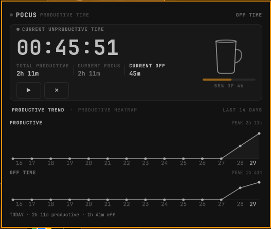
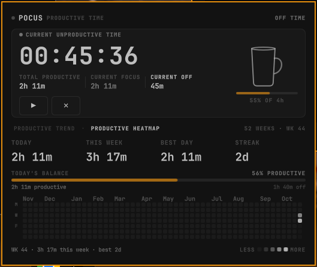

# Pocus

A focus-time tracker for the Omarchy bar. A small cup fills while you track, and a
panel shows your productive/off session timer, a 14-day trend chart, and a 52-week
focus heatmap.

| Trend view | Heatmap view |
| --- | --- |
|  |  |

## Features

- **Start / pause tracking** from the bar widget (right-click) or the panel.
- **Filling cup** in the bar and in the panel while you track, with a goal
  progress bar and a "X% OF Yh" label.
- **Current session + totals**: productive and off time, per session and per day.
- **14-day trend** charts with hoverable day summaries and peak markers.
- **52-week heatmap** with hover/pin per day, today's productive/off balance,
  weekly stats, best day, and streak.
- **Keyboard support** inside the panel: navigate pages, toggle the timer,
  arm the reset, switch panels.
- **IPC commands** for scripts and keybindings.

## Install

```sh
omarchy plugin add https://github.com/MOHIT-IITP/pocus.git --enable
```

> Adjust the URL if you cloned this repository under a different name.

`--enable` activates the plugin immediately; the bar widget starts in the right
section of the bar. Without it, enable afterwards with:

```sh
omarchy plugin enable io.github.mohiitp.pocus
```

Changes to the bar layout reload live — no shell restart needed.

## Usage

### Bar widget

- **Left-click** — open / close the panel.
- **Right-click** — start / pause tracking.
- **Middle-click** — open the panel straight to the heatmap page.
- Hovering shows a tooltip with today's totals and current session.

### Panel

- **Play / pause** button toggles tracking.
- **Reset** (✕) requires a confirm click ("SURE?") — it clears today's counters
  only; history is kept.
- The bottom strip is a swipe area: drag, scroll, or use the
  **Productive trend / Productive heatmap** tabs to move between pages.
- Hover the trend charts or heatmap and click a day to pin its summary.

### Keyboard (while the panel is open)

| Key | Action |
| --- | --- |
| `Space` / `Enter` | Start / pause tracking |
| `Arrow left / right` | Move between trend and heatmap pages |
| `G` or `1` | Trend page |
| `M` or `2` | Heatmap page |
| `R` (twice) | Arm / confirm reset of today |
| `Tab` | Switch to the neighboring bar panel |
| `Esc` | Close |

## Configure

- Set the **daily productive goal (hours)** in the widget's settings
  (default `4`), or via IPC:

  ```sh
  omarchy-shell pocus setGoal 240   # minutes
  ```

- Move the widget across bar sections:

  ```sh
  omarchy bar move io.github.mohiitp.pocus --section right
  ```

### IPC commands

All commands run through the shell IPC target `pocus`:

```sh
omarchy-shell pocus status         # JSON snapshot of the tracker
omarchy-shell pocus start          # start tracking
omarchy-shell pocus pause          # pause tracking
omarchy-shell pocus toggleTimer    # start/pause
omarchy-shell pocus open           # open the panel
omarchy-shell pocus close          # close the panel
omarchy-shell pocus graph          # open panel on the trend page
omarchy-shell pocus heatmap        # open panel on the heatmap page
omarchy-shell pocus reset          # clear today's counters
omarchy-shell pocus resetAll       # clear today AND history
```

For example, bind `omarchy-shell pocus toggleTimer` to a Hyprland keybinding.

## Data & storage

- All state lives in a single file, `~/.local/state/omarchy/pocus.json`
  (daily productive/off seconds and the history used by the trend and heatmap).
- The timer runs inside the Omarchy shell process; it advances once per second
  while tracking, so it pauses when the shell process pauses.
- Nothing is synced or shared anywhere.

## Security

Pocus runs, like every plugin, as unsandboxed code inside `omarchy-shell` — read
its code (it is small: QML + one JS module) before enabling. Labels and entry
points can be validated locally:

```sh
omarchy plugin validate .
```

What Pocus does **not** do:

- No network access — the source contains no HTTP/XMLHttpRequest calls and no
  telemetry.
- No external process execution — the only spawned command is
  `mkdir -p ~/.local/state/omarchy` to create its state directory.
- No sudo, no hooks, no `shell.json` edits — install/remove only changes
  Omarchy's own plugin registry through the official `omarchy plugin` CLI.
- No reads or writes outside its own plugin directory and
  `~/.local/state/omarchy/pocus.json` (written atomically).
- Exposes a single namespaced IPC target, `pocus`, limited to controlling its
  own timer and panel.

State is saved with atomic writes, and removing the plugin never deletes your
data (see below).

## Remove

```sh
omarchy plugin remove io.github.mohiitp.pocus
```

Your history stays in `~/.local/state/omarchy/pocus.json`; delete that file too
if you want a clean removal:

```sh
rm ~/.local/state/omarchy/pocus.json
```

## Reporting bugs and security issues

Open an issue at https://github.com/MOHIT-IITP/pocus/issues. For security-sensitive
reports, mark it clearly and avoid posting state files or personal context.

## License

[MIT](LICENSE)
